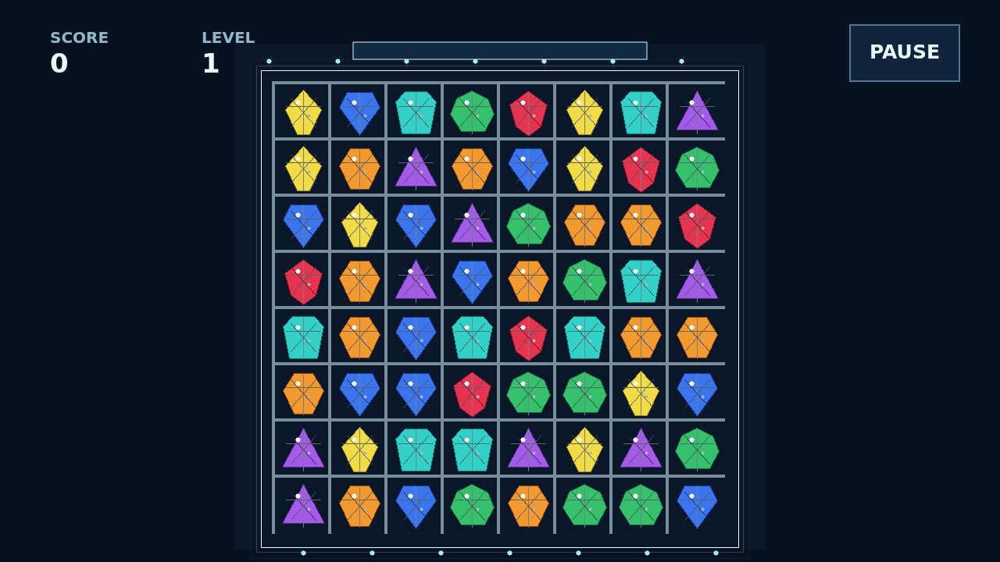

# Facet

Facet is a match game of cut stones on a lit board. Take hold of a gem, carry it
onto a neighbor, and let go to swap; three or more matching kinds shatter, then
new stones drop in from above.

Every clear presses on the stones beside it. A clean gem cracks, a cracked gem
fractures, and a flawed gem breaks with any clear that touches it. Flawed gems
are worth double, so a swap beside a stressed corner can turn into the move that
opens the board.

The best chains come from cuts. Four in a line leaves a brilliant that bursts
around itself, five or more leaves a prism that can harvest a whole kind, and a
crossed match leaves a star that takes its row and column.

Each level asks for a higher score target. Reach it to continue with a fresh
board, or play until no scoring swap remains.
